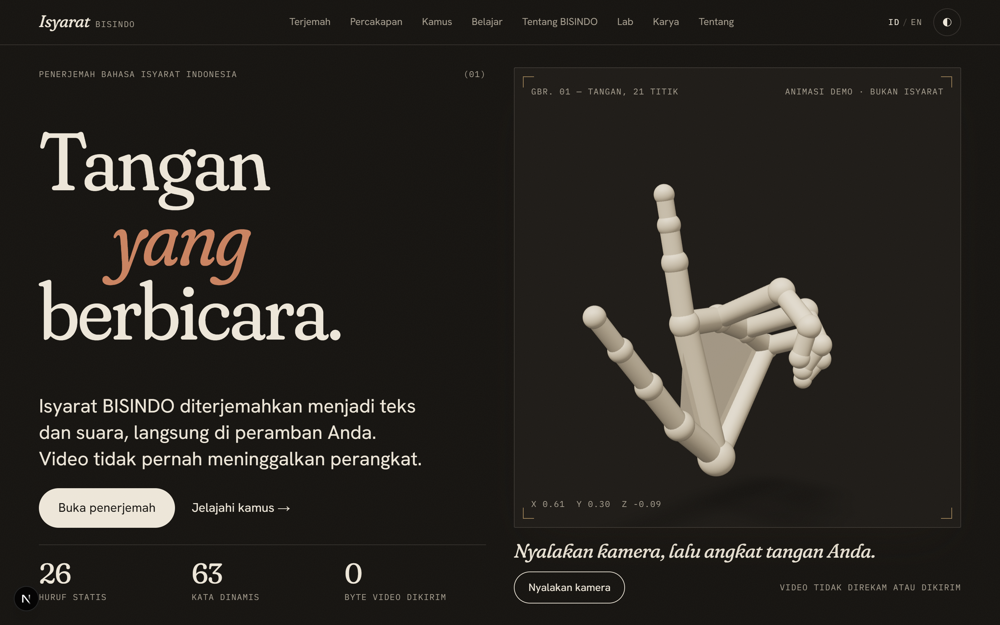
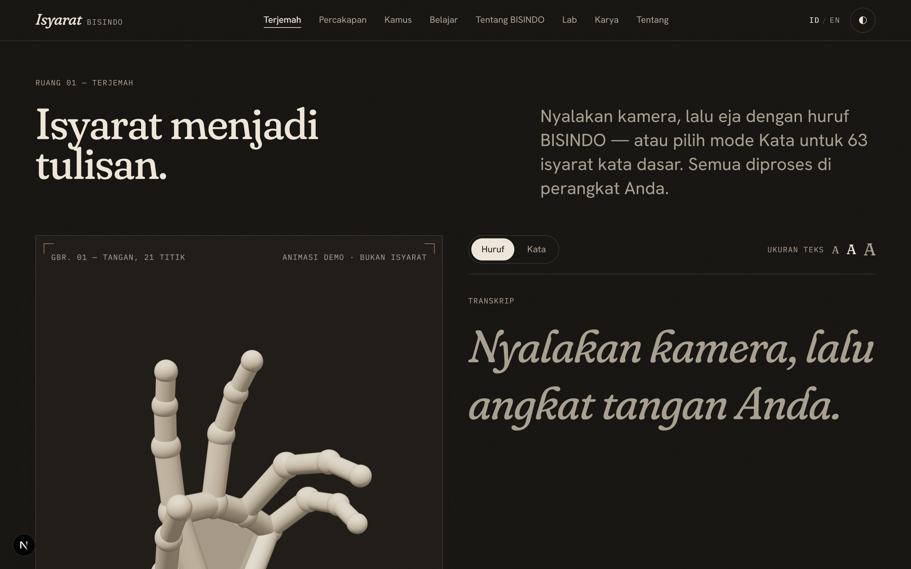
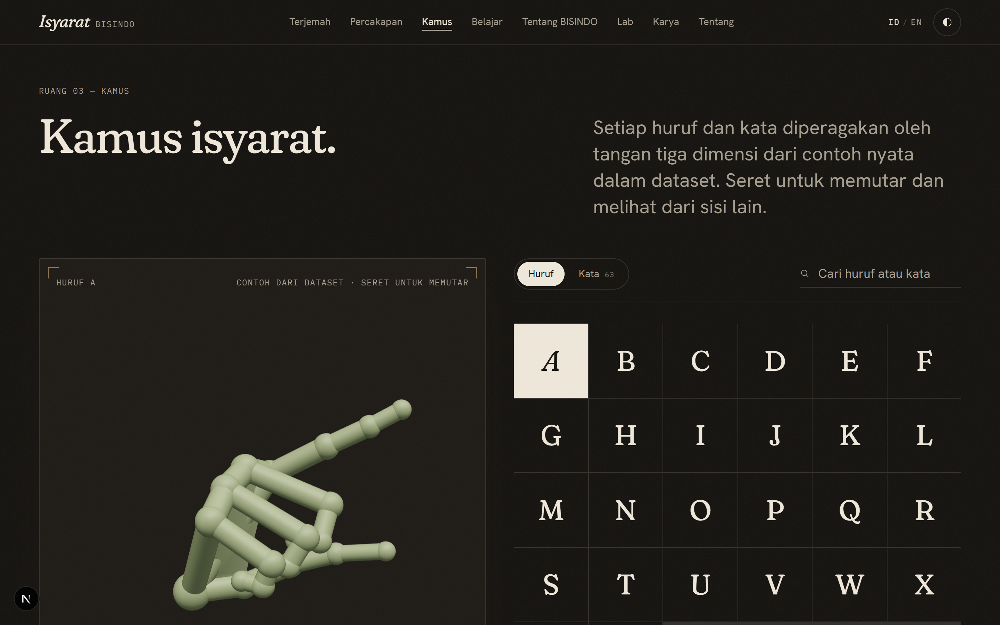
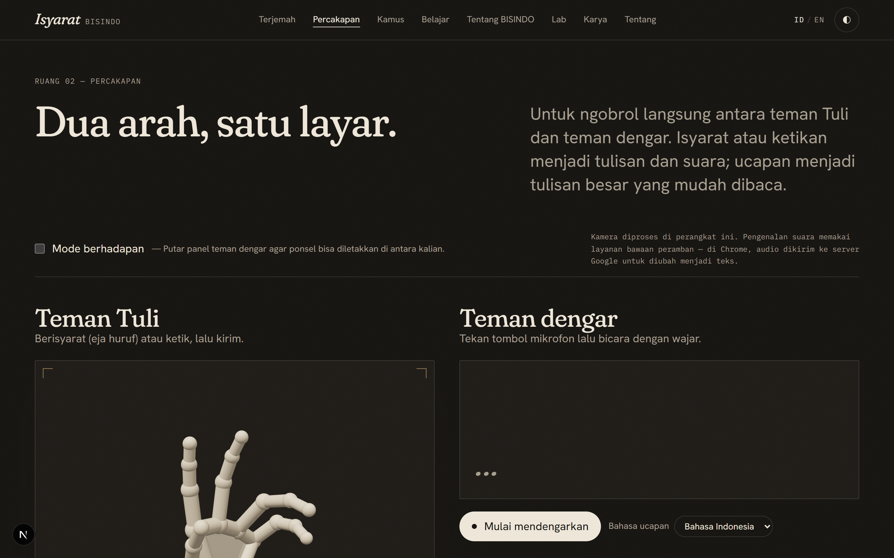

<div align="center">

# 🤲 Isyarat · BisindoCam

**Real-time Indonesian Sign Language (BISINDO) translation — entirely in your browser.**

[](https://nextjs.org)
[](https://react.dev)
[](https://mediapipe.dev)
[](https://onnxruntime.ai)
[-orange)](https://creativecommons.org/licenses/by-nc/4.0/)

> **🔒 Privacy-first · All inference runs on-device · No video ever leaves your browser**

[Live Demo *(coming soon)*](#) · [Dictionary](#pages--features) · [ML Pipeline](#ml-pipeline)

</div>

---

## 📸 Preview

<div align="center">
<table>
  <tr>
    <td align="center"><br/><sub><b>Home</b> · 3D interactive hero</sub></td>
    <td align="center"><br/><sub><b>Translate</b> · Live letter & word recognition</sub></td>
  </tr>
  <tr>
    <td align="center"><br/><sub><b>Dictionary</b> · 3D animated sign browser</sub></td>
    <td align="center"><br/><sub><b>Conversation</b> · Two-way signer session</sub></td>
  </tr>
</table>
</div>

---

## ✨ What is Isyarat?

Isyarat ("gesture" in Indonesian) is a **portfolio web application** that translates BISINDO — the hand-based sign language used by Indonesia's Deaf community — into text in real time. It uses your device's camera, processes every frame locally with MediaPipe and ONNX neural networks, and produces readable output with zero server round-trips.

The project demonstrates end-to-end machine learning deployment: from raw hand-landmark extraction and feature engineering, through scikit-learn / PyTorch model training, to ONNX quantization and in-browser inference.

---

## 🗂 Pages & Features

| Page | Route | Description |
|---|---|---|
| **Home** | `/` | 3D interactive hero (React Three Fiber), animated sign-language hand model |
| **Translate** | `/translate` | Live camera → text. Two modes: **Letter-by-letter** (fingerspelling) and **Full-word** recognition |
| **Conversation** | `/conversation` | Two-way signer session — signer + listener face each other; includes text-to-speech playback |
| **Dictionary** | `/dictionary` | Browse all 63 recognized words; each entry shows a looping 3D hand animation |
| **Learn** | `/learn` | Camera-based practice mode — sign a word, get instant feedback |
| **About BISINDO** | `/about-bisindo` | Educational page on BISINDO history and structure |
| **Lab** | `/lab` | Interactive ML results dashboard — confusion matrices, accuracy curves, dataset stats |
| **Work** | `/work` | Portfolio showcase of other projects |
| **About** | `/about` | Personal bio page |

---

## 🏗 Architecture

```
┌─────────────────────────────────────────────────────────┐
│                     Browser (client-only)                │
│                                                          │
│  ┌──────────┐    ┌─────────────────────────────────────┐ │
│  │  Camera  │───▶│  MediaPipe Tasks Vision (WASM)       │ │
│  │  (WebRTC)│    │  Hand Landmarker — 21 pts × 2 hands │ │
│  └──────────┘    └────────────────┬────────────────────┘ │
│                                   │ 42 (x,y,z) landmarks │
│                     ┌─────────────▼──────────────┐       │
│                     │    Feature Engineering      │       │
│                     │  Letters: 131-dim vector    │       │
│                     │  Words:   32×138-dim clip   │       │
│                     └─────────────┬──────────────┘       │
│                                   │                       │
│            ┌──────────────────────┼──────────────────┐   │
│            │                      │                   │   │
│   ┌────────▼────────┐   ┌────────▼────────┐          │   │
│   │  Letter MLP     │   │  Word BiGRU     │          │   │
│   │  (scikit-learn  │   │  "WordNet"      │          │   │
│   │   → ONNX 276KB) │   │  (PyTorch       │          │   │
│   │  26+ classes    │   │   → ONNX 1.7MB) │          │   │
│   └────────┬────────┘   │  63 classes     │          │   │
│            │            └────────┬────────┘          │   │
│            └──────────────────────┘                  │   │
│                         │                             │   │
│                  ┌──────▼──────┐                      │   │
│                  │  ONNX RT Web│                      │   │
│                  │  (inference)│                      │   │
│                  └──────┬──────┘                      │   │
│                         │ predicted label             │   │
│                  ┌──────▼──────┐                      │   │
│                  │  React UI   │                      │   │
│                  │  + Three.js │                      │   │
│                  └─────────────┘                      │   │
└─────────────────────────────────────────────────────────┘
```

---

## 🔧 Tech Stack

### Web

| Layer | Technology | Version |
|---|---|---|
| Framework | Next.js (App Router) | 16.4.3 |
| UI Library | React | 19 |
| Language | TypeScript | 5 |
| Styling | Tailwind CSS | v4 |
| 3D Rendering | React Three Fiber + Three.js | latest |
| Hand Tracking | MediaPipe Tasks Vision | ^1.1.1 |
| ML Inference | ONNX Runtime Web | ^1.30.0 |
| Animation | Framer Motion | latest |
| Testing | Vitest | latest |

### ML / Training

| Layer | Technology | Version |
|---|---|---|
| Runtime | Python | 3.12 |
| Package Manager | uv | latest |
| Letter Model | scikit-learn MLP | latest |
| Word Model | PyTorch (CPU) BiGRU | latest |
| ONNX Export | skl2onnx + torch.onnx | latest |
| Data Augmentation | NumPy + custom scripts | — |

---

## 🧠 ML Pipeline

### Letter Recognition

Fingerspelling classifier — recognizes individual BISINDO alphabet letters from a **single static frame**.

**Feature engineering** (131-dim vector per frame):

| Group | Dims | Description |
|---|---|---|
| Normalized landmarks | 63 | (x,y,z) × 21 joints, wrist-anchored + scale-normalized |
| Inter-joint distances | 20 | Key joint pairs (fingertip-to-wrist, etc.) |
| Finger angles | 20 | Per-phalanx bend angles |
| Palm orientation | 3 | Normal vector of palm plane |
| Handedness | 1 | Right/left flag |
| Cross-hand features | 24 | Relative distance + angle when both hands visible |

**Model**: `MLPClassifier` (scikit-learn) — 3 hidden layers, exported to ONNX (276 KB).

| Metric | Value |
|---|---|
| Evaluation | Leave-one-dataset-out |
| Top-1 Accuracy | 57 – 74.9% |
| Top-3 Accuracy | ~85% |
| Output classes | 26+ letters |
| Model size | 276 KB |

### Word Recognition ("WordNet")

Continuous word classifier — recognizes full BISINDO words from a **32-frame sliding window clip**.

**Feature engineering** (32 × 138-dim per clip):

| Group | Dims | Description |
|---|---|---|
| Normalized landmarks | 126 | (x,y,z) × 42 joints (both hands) |
| Velocity | 6 | Wrist + index-tip velocity per hand |
| Acceleration | 6 | First derivative of velocity |

**Model**: `BiGRU` (PyTorch, 2 layers, hidden 128) — exported to ONNX (1.757 MB).

| Metric | Value |
|---|---|
| Evaluation | Signer-independent 5-fold CV |
| Top-1 Accuracy | **83%** |
| Top-3 Accuracy | ~94% |
| Recognized words | 63 Indonesian words |
| Model size | 1.757 MB |
| Training runtime | ~15 min CPU |

### 63 Recognized Words

<details>
<summary>Click to expand full word list</summary>

```
aku          kamu         dia          kita         mereka
ini          itu          ada          tidak        ya
mau          minta        tolong       terima_kasih maaf
halo         selamat      pagi         siang        malam
makan        minum        tidur        kerja        belajar
pergi        datang       suka         cinta        senang
sedih        marah        takut        sakit        sehat
rumah        sekolah      kantor       toko         jalan
besar        kecil        bagus        jelek        baru
lama         cepat        lambat       banyak       sedikit
merah        biru         hijau        putih        hitam
satu         dua          tiga         empat        lima
ibu          bapak        adik         kakak
```

</details>

---

## 🚀 Getting Started

### Prerequisites

- Node.js ≥ 20
- pnpm (or npm/yarn)
- Python 3.12 (optional — only for retraining models)
- `uv` (optional — Python package manager)

### Web App

```bash
# 1. Clone
git clone https://github.com/Lal1602/BisindoCam.git
cd BisindoCam

# 2. Install dependencies
pnpm install

# 3. Start dev server
pnpm dev
```

Open [http://localhost:3000](http://localhost:3000). The first page load downloads the MediaPipe WASM bundle (~10 MB, cached after first load).

> **Note**: Camera access requires HTTPS or `localhost`. Remote dev servers need a reverse proxy with TLS.

### Production Build

```bash
pnpm build
pnpm start
```

---

## 🔬 ML Training Pipeline

> Training requires the WL-BISINDO dataset (see [Datasets](#datasets--attribution)). Due to its CC BY-NC 4.0 license, the raw data is **not included** in this repository.

### Setup Python environment

```bash
cd ml
uv sync          # creates .venv and installs all deps from pyproject.toml
```

### Letter model

```bash
# 1. Extract landmarks from your video dataset
uv run python extract_landmarks.py

# 2. Augment (optional — improves generalization)
uv run python augment_landmarks.py

# 3. Train MLP and export to ONNX
uv run python train_letter.py

# 4. Evaluate (leave-one-dataset-out)
uv run python evaluate_lodo.py
```

Output: `public/models/letter_model.onnx` (276 KB)

### Word model (WordNet)

```bash
# 1. Extract 32-frame clips + feature vectors
uv run python extract_word_clips.py

# 2. Train BiGRU
uv run python train_word.py

# 3. Export to ONNX
uv run python export_word_onnx.py

# 4. Evaluate (signer-independent 5-fold CV)
uv run python evaluate_word.py
```

Output: `public/models/word_model.onnx` (1.757 MB)

### Sign meta generation

```bash
# Generates signs/*.json — per-word landmark sequences for 3D dictionary animations
uv run python generate_signs_json.py
```

---

## 🎨 Design System

The visual language follows a theme called **"Kertas, Tanah, Cahaya Pagi"** (Paper, Earth, Morning Light) — warm, analogue, human.

| Token | Value | Usage |
|---|---|---|
| `paper` | `#F5F0E8` | Page background |
| `ink` | `#2C2416` | Primary text |
| `clay` | `#C4A882` | Borders, dividers |
| `moss` | `#4A6741` | Accent / success |
| `brass` | `#B8860B` | Highlight / warning |
| `cream` | `#EDE8DC` | Card backgrounds |

**Fonts**:
- **Fraunces** — serif display, headings
- **Hanken Grotesk** — clean sans, body text
- **IBM Plex Mono** — code / data labels

---

## 📦 Project Structure

```
bisindocam/
├── app/                   # Next.js App Router pages
│   ├── translate/         # Main translation page
│   ├── conversation/      # Two-way signer mode
│   ├── dictionary/        # 3D word browser
│   ├── learn/             # Practice mode
│   ├── lab/               # ML results dashboard
│   └── ...
├── components/
│   ├── camera/            # Camera capture + MediaPipe integration
│   ├── translator/        # Letter & word inference logic
│   ├── three/             # React Three Fiber scenes & hand models
│   └── ui/                # Shared design-system components
├── lib/
│   ├── mediapipe/         # Hand landmarker wrapper
│   ├── onnx/              # ONNX RT Web loader + inference
│   ├── features/          # Feature extraction (letters + words)
│   └── signs/             # Signs JSON loader (dictionary data)
├── ml/                    # Python training pipeline
│   ├── train_letter.py
│   ├── train_word.py
│   ├── extract_landmarks.py
│   ├── evaluate_lodo.py
│   └── ...
├── public/
│   ├── models/            # Compiled ONNX models (276 KB + 1.7 MB)
│   └── signs/             # Per-word JSON landmark sequences
└── briefings/             # Internal project documentation
```

---

## ⚠️ Known Limitations

| Issue | Root Cause | Workaround |
|---|---|---|
| Two-hand overlap not detected | MediaPipe drops the occluded hand; cross-hand features are zeroed | Keep both hands in frame and slightly separated |
| Camera appears zoomed in | `object-cover` on portrait container crops 30–45% of landscape feed | Use landscape orientation; ensure camera is 1–2 m away |
| Camera feed has a warm brown tint | Intentional aesthetic filter: `grayscale-[0.7] sepia-[0.25] opacity-45` | By design — reflects the "Kertas, Tanah" visual theme |

---

## 📊 Datasets & Attribution

| Dataset | Source | License | Usage |
|---|---|---|---|
| WL-BISINDO | [Mendeley Data](https://data.mendeley.com/datasets/p7f35vg73k) | CC BY-NC 4.0 | Word model training |
| Custom collection | Recorded by author | Proprietary | Letter model training supplement |

> **Important**: The WL-BISINDO dataset is licensed under **CC BY-NC 4.0** (non-commercial). Any derivative of this project that uses the trained word model must respect this license.

Please cite the original dataset when using this project in academic work:

> *Apriyanti, D. H., et al. (2022). WL-BISINDO: Word-Level BISINDO Dataset. Mendeley Data.*

---

## 🤝 Contributing & Feedback

This is a personal portfolio project, but feedback is warmly welcome.

- **Bug reports**: Open an [issue](https://github.com/Lal1602/BisindoCam/issues) with a screen recording if possible
- **Accuracy improvements**: PRs for the ML pipeline (new data, better features, architecture changes) are appreciated
- **Accessibility**: The Deaf and hard-of-hearing community's perspective is especially valuable — please reach out

---

## 📄 License

**Source code**: MIT License — free to use, modify, and distribute with attribution.

**Trained word model** (`word_model.onnx`): Derived from WL-BISINDO data — licensed under **CC BY-NC 4.0**. Non-commercial use only.

---

<div align="center">

Made with care by **Bilal** · Indonesia 🇮🇩

*"Tangan yang berbicara." — Hands that speak.*

</div>
